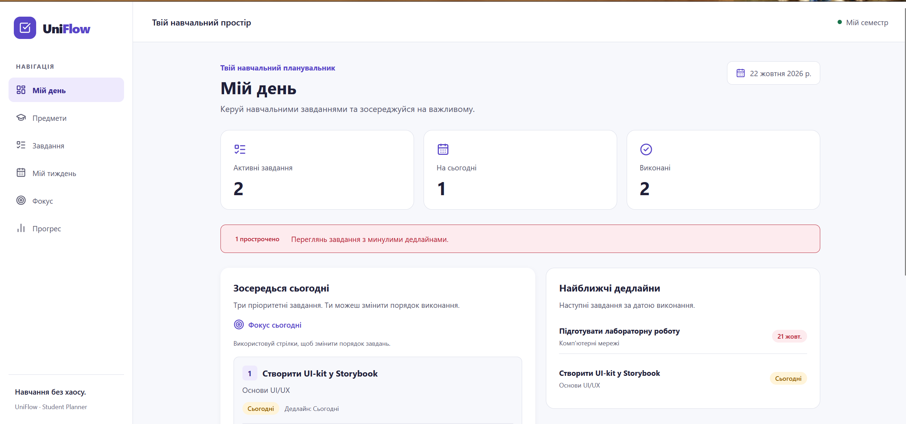
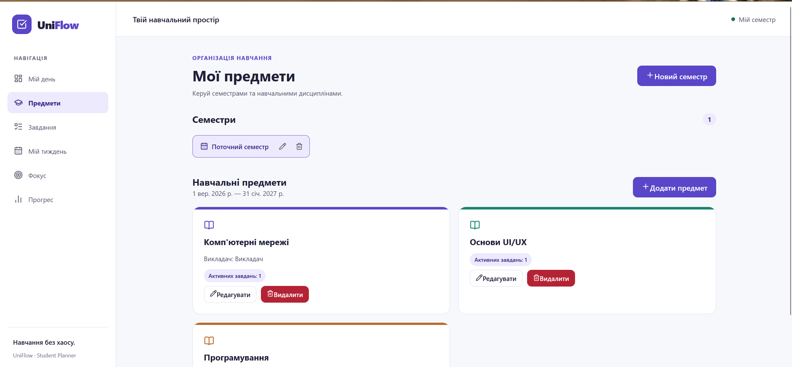
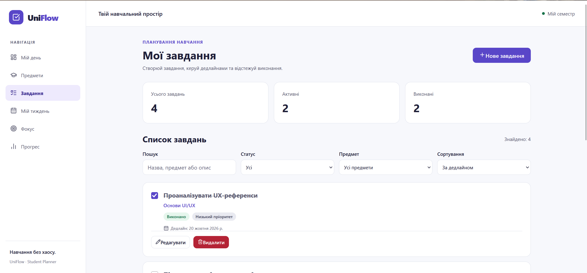
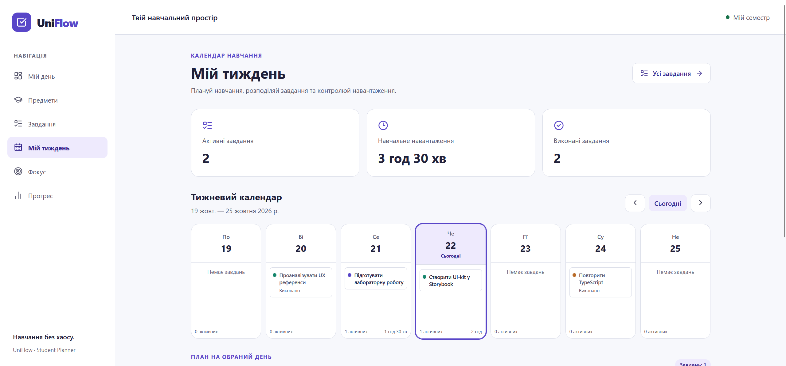
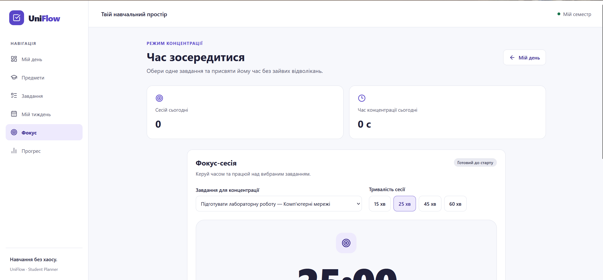
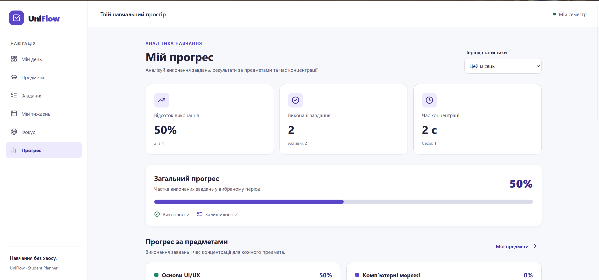

# UniFlow — Student Study Planner

**UniFlow** — інтерактивний вебзастосунок для організації навчальної діяльності студентів. Він допомагає керувати предметами, планувати завдання, відстежувати дедлайни, концентруватися на навчанні та аналізувати власний прогрес.

Проєкт розроблено в межах практичної роботи №2 з дисципліни UI/UX Design як **AI-assisted code-first прототип**, який може бути розширений до повноцінної інформаційної системи.

## Мета проєкту

Основна мета UniFlow — об'єднати управління навчальними завданнями, планування часу та відстеження прогресу в одному зручному адаптивному інтерфейсі.

Застосунок орієнтований на студентів, яким необхідно працювати з кількома навчальними дисциплінами, паралельними дедлайнами та різними рівнями пріоритетності завдань.

## Основні можливості

### Today Dashboard

- Відображення загальної кількості активних і виконаних завдань.
- Перегляд завдань із дедлайном на сьогодні.
- Попередження про прострочені завдання.
- Автоматичний підбір трьох пріоритетних завдань у Focus Today.
- Ручне впорядкування рекомендованих завдань зі збереженням порядку.
- Перехід до Focus Mode для вибраного завдання.

### Subjects & Semesters

- Створення, перегляд, редагування та видалення семестрів.
- Керування навчальними дисциплінами.
- Призначення предметам кольорів і додаткових характеристик.
- Зв'язок навчальних завдань із відповідними предметами.

### Tasks

- Створення, редагування та видалення завдань.
- Визначення дедлайну, пріоритету та складності.
- Вказування орієнтовного часу виконання.
- Вибір дати й часу запланованої роботи.
- Позначення завдань виконаними.
- Пошук, фільтрація та сортування.
- Перевірка введених даних.

### Week Calendar

- Перегляд навчальних завдань у тижневому календарі.
- Перемикання між тижнями.
- Вибір конкретного дня для перегляду завдань.
- Відображення предмета, пріоритету та запланованого часу.
- Визначення днів із підвищеним навчальним навантаженням.
- Зміна статусу завдань із календаря.

### Focus Mode

- Вибір активного навчального завдання.
- Таймер концентрації на 15, 25, 45 або 60 хвилин.
- Запуск, пауза, продовження, завершення та скасування сесії.
- Збереження стану таймера після перезавантаження сторінки.
- Історія завершених фокус-сесій.
- Облік фактично витраченого часу.
- Можливість позначити завдання виконаним після сесії.

### Progress

- Загальна статистика навчальних завдань.
- Відсоток виконання за вибраний період.
- Прогрес за окремими дисциплінами.
- Облік завершених фокус-сесій.
- Перегляд найближчих дедлайнів.
- Інформація про прострочені завдання.
- Перемикання між статистикою за тиждень, місяць і весь час.

## Скриншоти інтерфейсу

Скриншоти розміщені в директорії `docs/screenshots/`.

| Today Dashboard                                | Subjects                                   |
| ---------------------------------------------- | ------------------------------------------ |
|  |  |

| Tasks                                | Week Calendar                               |
| ------------------------------------ | ------------------------------------------- |
|  |  |

| Focus Mode                                  | Progress                                   |
| ------------------------------------------- | ------------------------------------------ |
|  |  |

## Технологічний стек

| Технологія                    | Призначення                          |
| ----------------------------- | ------------------------------------ |
| React                         | Побудова інтерфейсу                  |
| TypeScript                    | Статична типізація                   |
| Vite                          | Середовище розробки та збірка        |
| React Router                  | Маршрутизація                        |
| React Context API             | Спільний стан застосунку             |
| CSS / CSS Custom Properties   | Стилізація та дизайн-токени          |
| Lucide React                  | Іконки                               |
| Storybook                     | Документування компонентів UI-kit    |
| Storybook Accessibility Addon | Автоматизовані перевірки доступності |
| ESLint                        | Статичний аналіз коду                |
| localStorage                  | Локальне збереження даних            |
| Git / GitHub                  | Контроль версій                      |

## Встановлення та запуск

### Вимоги

- Node.js сумісної з проєктом версії.
- npm.
- Сучасний веббраузер.

### 1. Завантаження проєкту

```bash
git clone https://github.com/aanimra/UniFlow.git
cd uniflow
```

### 2. Встановлення залежностей

```bash
npm ci
```

### 3. Запуск локального сервера

```bash
npm run dev
```

Після запуску Vite в терміналі буде показано локальну адресу застосунку:

`http://localhost:5173/`

### 4. Production-збірка

```bash
npm run build
```

### 5. Попередній перегляд збірки

```bash
npm run preview
```

### 6. Перевірка коду

```bash
npm run lint
```

## Storybook і UI-kit

UniFlow використовує повторно застосовувані UI-компоненти:

- Button
- Input
- Select
- Badge
- Card

Компоненти мають спільні дизайн-токени та незалежні Storybook stories.

Запуск Storybook:

```bash
npm run storybook
```

Збірка Storybook:

```bash
npm run build-storybook
```

Якщо скрипт збірки відсутній, можна виконати:

```bash
npx storybook build
```

## Дизайн-система

Основні кольори:

| Токен      | Значення  |
| ---------- | --------- |
| Primary    | `#5946C8` |
| Background | `#F7F8FC` |
| Text       | `#202039` |
| Success    | `#19734B` |
| Error      | `#B42335` |

Дизайн-система також містить змінні для відступів, типографіки, радіусів, станів компонентів і візуальних ефектів.

Файл із дизайн-токенами: `src/styles/tokens.css`.

## Інформаційна архітектура

Застосунок складається із шести основних розділів:

```text
UniFlow
├── Today
├── Subjects
│   ├── Semesters
│   └── Subjects management
├── Tasks
│   ├── Task list
│   └── Task form
├── Week
│   ├── Weekly calendar
│   └── Day details
├── Focus
│   ├── Timer
│   └── Session history
└── Progress
    ├── General statistics
    └── Subject statistics
```

Документи з інформаційної архітектури:

- [Sitemap](docs/diagrams/sitemap.svg)
- [User Flow](docs/diagrams/user-flow.svg)

## UI/UX-дослідження

У межах практичної роботи виконано:

1. Порівняльний аналіз Figma, Google Stitch, v0 і Lovable.
2. Формування інформаційної архітектури UniFlow.
3. Побудову Sitemap і розгалуженого User Flow.
4. Розробку мудборду на основі реальних інтерфейсів.
5. Створення дизайн-системи та UI-kit.
6. Реалізацію інтерактивного прототипу.
7. Перевірку адаптивності, клавіатурної навігації та доступності.

Матеріали дослідження:

- [Порівняння інструментів](docs/research/tool-comparison.md)
- [Moodboard](docs/moodboard/moodboard.html)
- [Аналіз референсів](docs/moodboard/moodboard-analysis.md)
- [Аудит доступності](docs/research/accessibility-audit.md)

## Доступність та адаптивність

Інтерфейс спроєктовано з урахуванням вимог WCAG 2.2 AA.

Реалізовано:

- семантичні HTML-елементи;
- підписані поля введення;
- видимі стани клавіатурного фокусу;
- клавіатурне керування основними функціями;
- текстові позначення статусів;
- адаптивне компонування;
- підтримку налаштування `prefers-reduced-motion`.

Виконано ручну перевірку основних екранів і компонентів. Результати задокументовано у файлі `docs/research/accessibility-audit.md`.

Проведене тестування не є формальною сертифікацією повної відповідності всім критеріям WCAG.

## Збереження даних

Поточна версія UniFlow є клієнтським прототипом.

Семестри, предмети, завдання й історія фокус-сесій зберігаються в `localStorage` браузера. Параметри поточного таймера та ручний порядок Focus Today також зберігаються локально.

Дані не синхронізуються між пристроями та браузерами. Видалення локальних даних браузера може призвести до втрати збереженої інформації.

## Поточні обмеження

- Відсутня серверна частина та користувацька автентифікація.
- Дані зберігаються лише в поточному браузері.
- Немає синхронізації між пристроями.
- Потрібне подальше автоматизоване й користувацьке тестування.

## Подальший розвиток

У наступних ітераціях планується:

- синхронізація завдань між пристроями;
- розширення автоматизованих тестів;
- удосконалення рекомендацій навчального навантаження.

## Призначення

Навчальний проєкт, розроблений для демонстрації процесу UI/UX-проєктування, побудови дизайн-системи та створення інтерактивного вебпрототипу.
